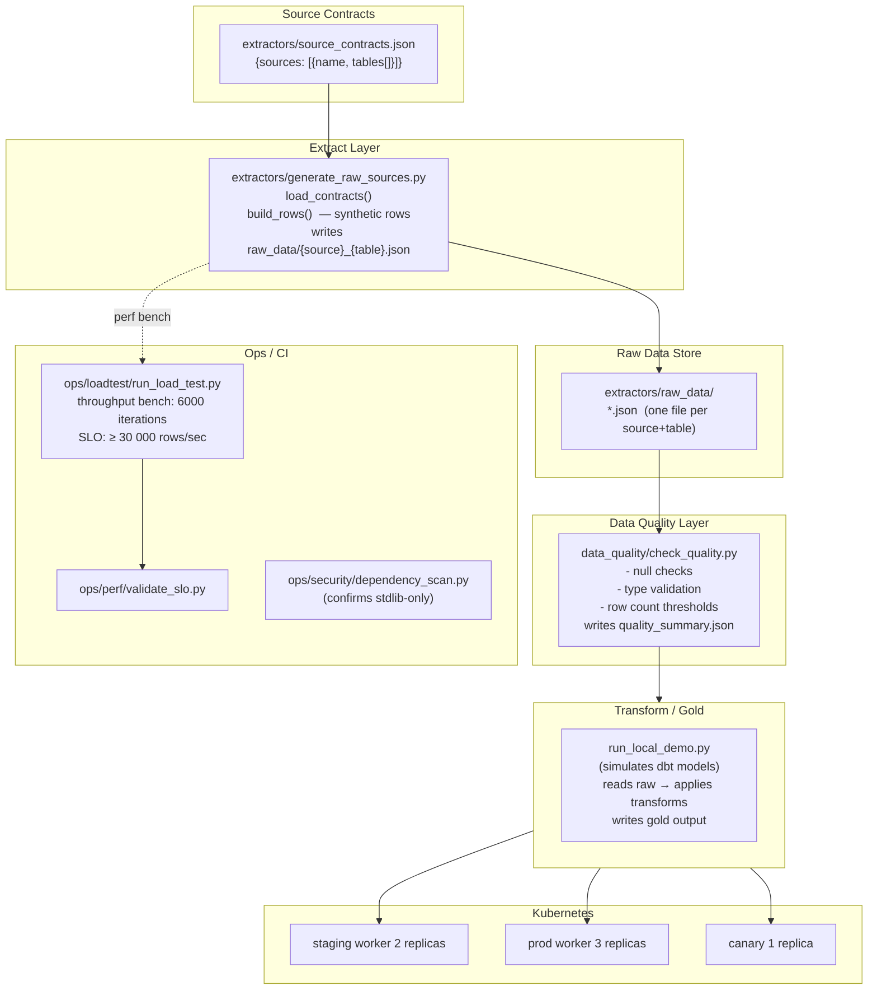
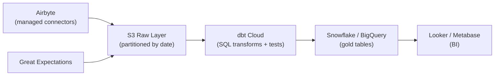

# Architecture — Modern ELT Platform

## Overview

The Modern ELT Platform simulates a data engineering extraction, load, and transform pipeline. Source contracts define which tables to extract from which systems. Extractors generate raw source files. A data quality layer validates extracted rows before promotion. The entire pipeline is stdlib-only Python — no Airbyte, dbt, or Snowflake dependency in the demo.

## Component Diagram



## Data Flow

1. **Contract read** — `load_contracts()` reads `source_contracts.json` to discover sources and tables
2. **Row generation** — `build_rows(source, table)` generates synthetic rows with `row_id`, `payload`, `ingested_at`
3. **Raw write** — One JSON file per `{source}_{table}` pair written to `extractors/raw_data/`
4. **Quality check** — `check_quality.py` validates null rates, row counts, and type consistency; writes quality summary
5. **Transform** — `run_local_demo.py` applies column projections and aggregations (simulating dbt models)
6. **SLO gate** — Throughput benchmark ensures `build_rows()` sustains ≥ 30 000 rows/sec in CI

## Source Contract Schema

```json
{
  "sources": [
    {
      "name": "payments_db",
      "tables": ["transactions", "refunds", "chargebacks"]
    }
  ]
}
```

## Key Design Decisions

| Decision                   | Rationale                                                                             |
| -------------------------- | ------------------------------------------------------------------------------------- |
| Contract-driven extraction | Schema is declared before running — prevents extracting undeclared tables             |
| Synthetic row generation   | Demo-portable without real DB connectivity; swap `build_rows` for a DB cursor in prod |
| Per-table output files     | Maps naturally to partitioned S3/GCS paths in a real lakehouse                        |
| Quality before promotion   | Rows failing quality checks never reach the gold layer                                |
| Stdlib-only                | Zero dependencies; replace with Airbyte connectors and dbt models in production       |

## Production Architecture (Target)



## Directory Map

```
modern-elt-platform/
├── extractors/
│   ├── generate_raw_sources.py  # extract + build rows
│   ├── source_contracts.json    # schema declaration
│   └── raw_data/                # output JSON files
├── data_quality/
│   └── check_quality.py         # row-level validation
├── run_local_demo.py            # end-to-end demo
├── tests/test_elt_scripts.py
├── deploy/k8s/
│   ├── staging/ prod/ canary/
├── ops/
│   ├── alerts/ loadtest/ perf/ runbooks/ security/
└── .github/workflows/ci.yml
```
